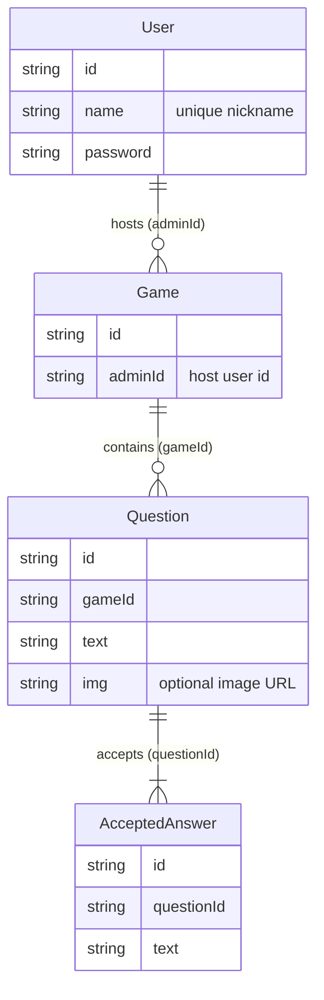

# 5. Domain model and glossary

## Stored entities

These entities are stored in the database (SQLite, via Prisma).

The relations are logical only: the database schema has no foreign keys, so deleting a quiz does not delete its questions automatically.

## Live (in-memory) entities

These entities exist only while a game is running and are lost when it ends.

| Entity | Fields | Notes |
|---|---|---|
| Active game | quiz ID, players, all questions, active question ID | One per server (BR-20) |
| Player | user ID, nickname, color, answers | Created when a user joins; removed on disconnect |
| Player answer | question ID, text, correct or not | Correctness is computed when the answer arrives |

## Glossary

| Term | Meaning | Name in code |
|---|---|---|
| Quiz | A set of questions prepared by a host. Called "game" in the code. | `Game` |
| Host | The user who created a quiz and runs it live | `adminId`, "admin" in routes |
| Live game | A quiz that is currently being played | `gameInstance`, `ActiveGame` |
| Game ID | Identifier that players enter to join. Shown in the UI as the "link for the players". | `gameId` |
| Question | A prompt with text and an optional image | `Question` |
| Accepted answer | A text that counts as a correct answer to a question. A question can have several. | `AcceptedAnswer` |
| Active question | The question that players see and answer right now | `activeQuestionId` |
| Reveal | Showing all players' answers to the active question | `SHOW_ANSWERS` |
| Score | Number of correct answers of a player | computed in `WinnersTable` |
| Winners table | Final leaderboard sorted by score | `WinnersTable` |
