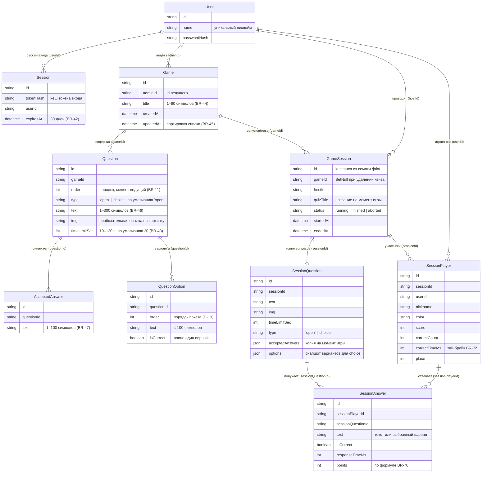

# 5. Доменная модель и глоссарий

## Хранимые сущности

Эти сущности хранятся в базе данных (PostgreSQL через Prisma). Соответствует целевой модели из [раздела 9.7](09-target-requirements.md#97-целевая-доменная-модель) плюс `Session` (сессия входа) и `QuestionOption` ([документ 13](13-multiple-choice-questions.md)).

Связи — настоящие внешние ключи. Удаление квиза каскадно удаляет вопросы, принимаемые ответы и варианты (`onDelete: Cascade`), но не историю: `GameSession.gameId` становится `NULL` (`onDelete: SetNull`), а копия вопросов (`SessionQuestion`) и название квиза (`quizTitle`) сохраняются (BR-81). Сеанс и всё его содержимое удаляются каскадом по `sessionId` (BR-82).

## Сущности живой игры (в памяти)

Состояние идущего сеанса хранится в памяти сервера — комнаты в `Map<sessionId, Room>` на одном экземпляре (`ActiveGameService`). Результаты записываются в базу при закрытии каждого вопроса и при завершении сеанса (NFR-R6); при перезапуске сервера идущие сеансы прерываются и попадают в историю со статусом «прервана» (NFR-R7).

| Сущность | Поля | Примечания |
|---|---|---|
| Сеанс игры (комната) | `sessionId`, `gameId`, название квиза, `hostId`, состояние (лобби → вопрос → ответы → победители), номер текущего вопроса, снапшот вопросов с принимаемыми ответами и вариантами, игроки, сокеты, таймер вопроса, grace-таймер ведущего | Одновременно много комнат (BR-50); события рассылаются только участникам комнаты |
| Игрок в сеансе | id пользователя, никнейм, цвет, «в сети», «ответил», ответы и очки | Отключение не удаляет игрока — статус «не в сети» до конца (BR-58) |
| Ответ игрока | текст или `optionId`, правильность, время ответа, очки | Первый ответ считается (BR-63); правильность вычисляется при получении |

## Глоссарий

| Термин | Значение | Название в коде |
|---|---|---|
| Квиз | Набор вопросов, подготовленный ведущим. В коде называется «game». | `Game` |
| Ведущий | Пользователь, который создал квиз и проводит его вживую | `adminId`, `hostId`, «admin» в маршрутах |
| Сессия входа | Долгоживущая сессия аккаунта (30 дней): токен в localStorage клиента, в базе — его хеш | `Session`, `Authorization: Bearer` |
| Сеанс игры | Один запуск квиза вживую со своей ссылкой-приглашением; запись о нём — история игр | `GameSession`, `sessionId`, комната `Room` |
| Ссылка-приглашение | URL, по которому игроки подключаются к сеансу; QR-код кодирует её | `/join/<sessionId>`, `joinPath` |
| Вопрос | Задание с текстом и необязательной картинкой. Тип `open` — ответ текстом, `choice` — выбор из вариантов | `Question` |
| Принимаемый ответ | Текст, который считается правильным ответом на вопрос `open`. У вопроса их может быть несколько. | `AcceptedAnswer` |
| Вариант ответа | Один из 2–4 предложенных ответов вопроса `choice`; верным помечен ровно один ([документ 13](13-multiple-choice-questions.md)) | `QuestionOption` |
| Текущий вопрос | Вопрос, который игроки видят и на который отвечают сейчас | `question` в `SESSION_STATE` |
| Показ ответов | Показ ответов всех игроков на текущий вопрос с правильностью и очками | `ANSWERS_REVEALED` |
| Очки | Очки за правильные ответы с бонусом за скорость по формуле BR-70 | `score`, `points` |
| Таблица победителей | Итоговый рейтинг по очкам с тай-брейком по времени (BR-72) | `WINNERS`, `WinnersTable` |
| История игр | Сохранённые записи о прошлых сеансах у ведущего | `GameSession` + `Session*` |
