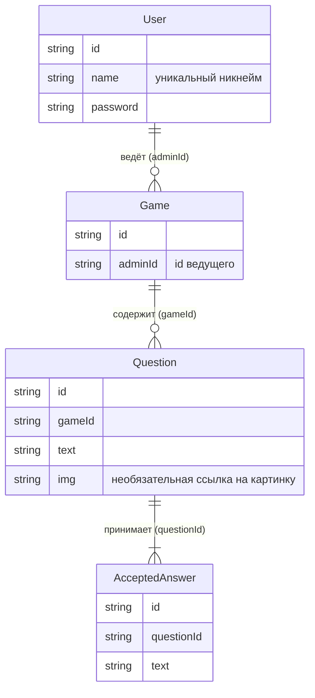

# 5. Доменная модель и глоссарий

## Хранимые сущности

Эти сущности хранятся в базе данных (SQLite через Prisma).

Связи только логические: в схеме базы нет внешних ключей, поэтому удаление квиза не удаляет его вопросы автоматически.

## Сущности живой игры (в памяти)

Эти сущности существуют, только пока идёт игра, и теряются после её окончания.

| Сущность | Поля | Примечания |
|---|---|---|
| Живая игра | ID квиза, игроки, все вопросы, ID активного вопроса | Одна на сервер (BR-20) |
| Игрок | ID пользователя, никнейм, цвет, ответы | Создаётся при подключении; удаляется при отключении |
| Ответ игрока | ID вопроса, текст, верный или нет | Правильность вычисляется при получении ответа |

## Глоссарий

| Термин | Значение | Название в коде |
|---|---|---|
| Квиз | Набор вопросов, подготовленный ведущим. В коде называется «game». | `Game` |
| Ведущий | Пользователь, который создал квиз и проводит его вживую | `adminId`, «admin» в маршрутах |
| Живая игра | Квиз, который сейчас играется | `gameInstance`, `ActiveGame` |
| ID игры | Идентификатор, который вводят игроки для подключения. В интерфейсе называется «ссылкой для игроков». | `gameId` |
| Вопрос | Задание с текстом и необязательной картинкой | `Question` |
| Принимаемый ответ | Текст, который считается правильным ответом на вопрос. У вопроса их может быть несколько. | `AcceptedAnswer` |
| Активный вопрос | Вопрос, который игроки видят и на который отвечают сейчас | `activeQuestionId` |
| Показ ответов | Показ ответов всех игроков на активный вопрос | `SHOW_ANSWERS` |
| Очки | Число правильных ответов игрока | вычисляется в `WinnersTable` |
| Таблица победителей | Итоговый рейтинг, отсортированный по очкам | `WinnersTable` |
