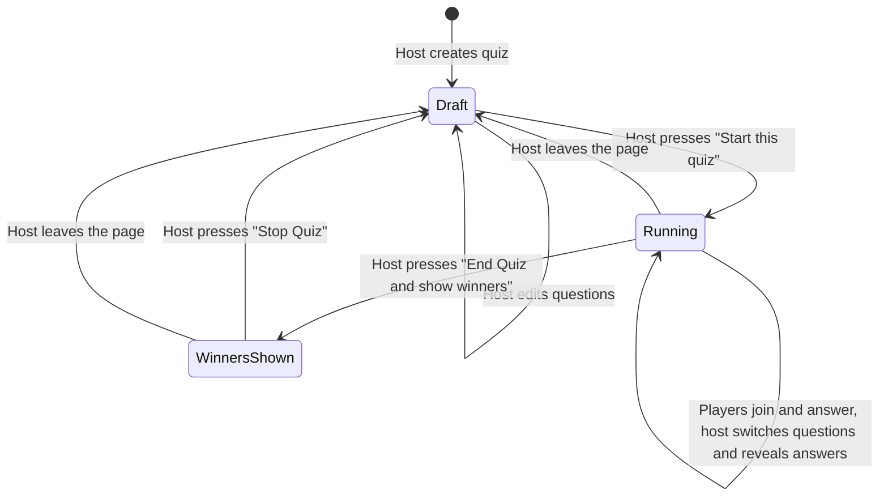
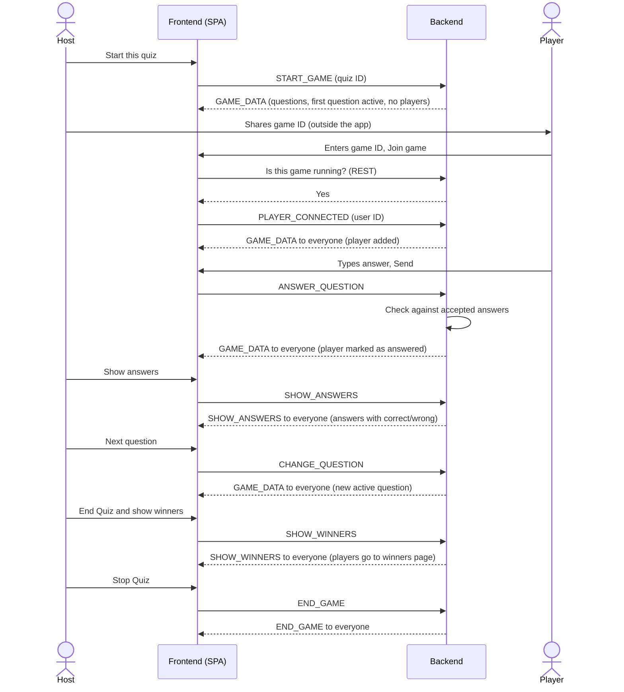

# 6. Live game flow

## Game lifecycle

A quiz can be played again: after a game ends, the quiz returns to the draft state and can be started again. Results of the previous run are not kept.

## End-to-end scenario

## Real-time messages

All live events go over one WebSocket connection per browser tab. Each message is JSON `{ "type": ..., "payload": ... }`.

### From clients to server

| Message | Sent by | Payload | Business meaning |
|---|---|---|---|
| `START_GAME` | Host | quiz ID | Start the quiz live |
| `PLAYER_CONNECTED` | Player | user ID | Join the running game |
| `CHANGE_QUESTION` | Host | question ID | Make a question active |
| `ANSWER_QUESTION` | Player | question ID, answer text, user ID | Send an answer |
| `SHOW_ANSWERS` | Host | question ID | Reveal answers to the question |
| `SHOW_WINNERS` | Host | none | Show the winners table |
| `END_GAME` | Host | none | Stop the game |

### From server to clients

| Message | Payload | Business meaning |
|---|---|---|
| `GAME_DATA` | full live game state | Players, questions or active question changed |
| `SHOW_ANSWERS` | each player's answer to the question with correct/wrong | Reveal |
| `SHOW_WINNERS` | none | Go to the winners table |
| `END_GAME` | none | The game is over |
| `FAULT` | error text | The action was rejected (game already running, no game running) |

Server messages are sent to **every** connected client, not only to the players of a specific game. This works only because one game runs at a time (BR-20).

The server does not check who sends a message: any connected client can send host messages such as `CHANGE_QUESTION` or `END_GAME` (see [GAP-3](08-gaps-and-backlog.md)).
