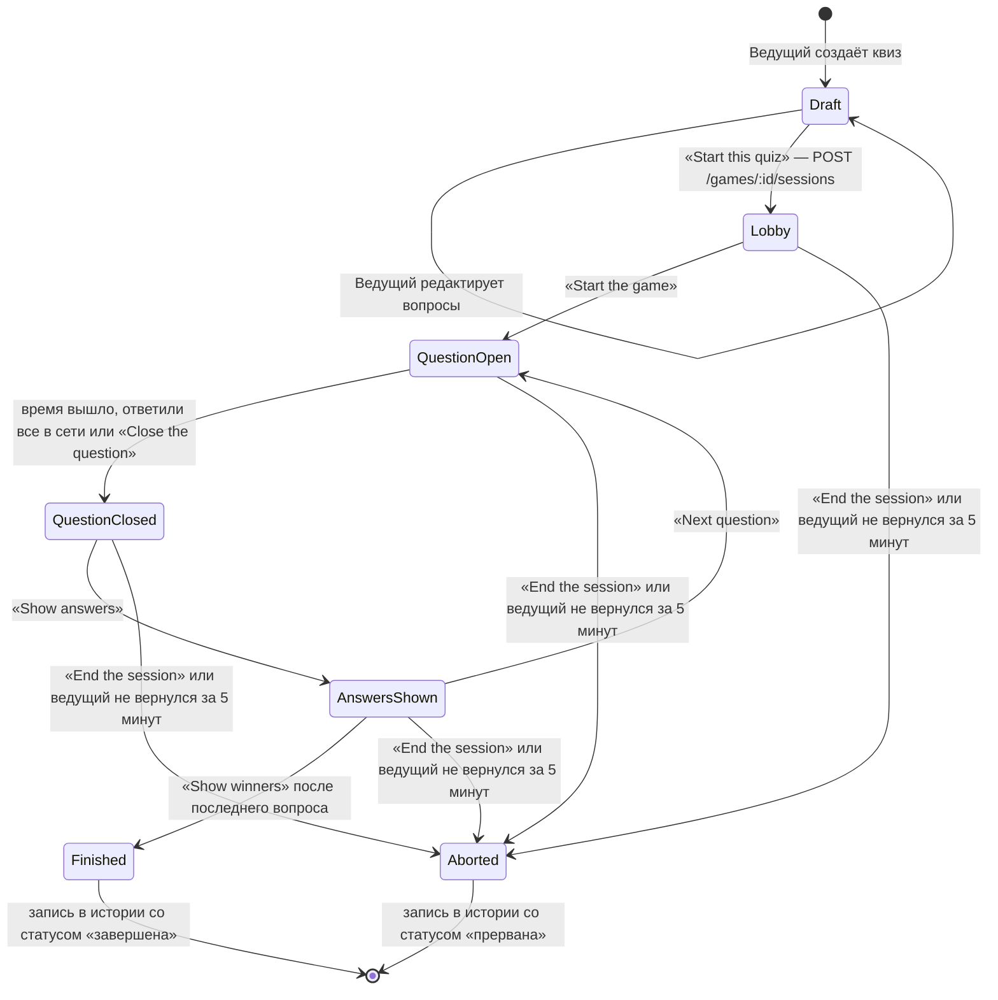
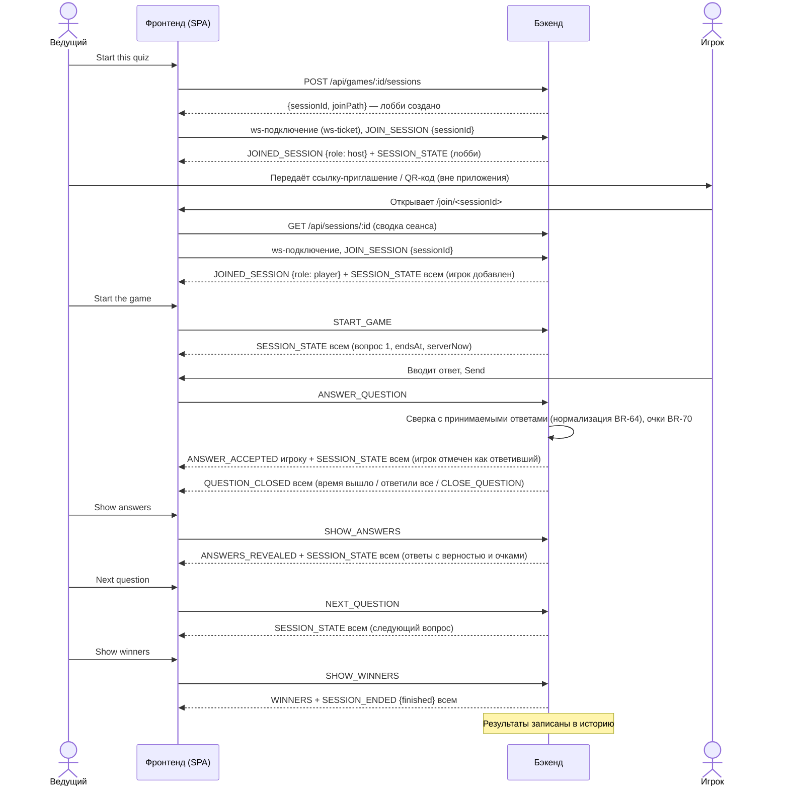

# 6. Сценарий живой игры

Здесь описан текущий сценарий — сеансовый протокол версии 1.0 (реализован в этапах 4a–5). Точное описание сообщений — в `backend/docs/websocket-protocol.md`.

## Жизненный цикл игры

Состояния: `Draft` — квиз в конструкторе, `Lobby` — лобби сеанса, `QuestionOpen` — вопрос идёт, `QuestionClosed` — вопрос закрыт, `AnswersShown` — ответы показаны, `Finished` — победители показаны, `Aborted` — игра прервана (BR-55).

Каждый запуск — отдельный сеанс с собственной ссылкой-приглашением; одновременно может идти много сеансов (BR-50). Квиз можно сыграть повторно: каждая игра создаёт новую запись в истории (BR-80). Пока сеанс идёт, квиз нельзя редактировать или удалять (BR-54).

## Сквозной сценарий

## Сообщения реального времени

WebSocket-соединение открывается для конкретного сеанса: `ws://host/ws?ticket=<ticket>`, одноразовый короткоживущий билет выдаёт `POST /api/auth/ws-ticket` под сессию входа (D-9). Каждое сообщение — JSON вида `{ "type": ..., "payload": ... }` до 16 КБ; серверный ping каждые 30 с.

Сообщения ведущего сервер принимает только от ведущего этого сеанса (`FAULT FORBIDDEN` иначе). События рассылаются только участникам сеанса — комнаты изолированы (BR-50). Отправителю на отклонённое действие приходит `FAULT {code, message}`. Лимит — 30 команд за 10 с с одного соединения (`RATE_LIMITED`).

### От клиентов к серверу

| Сообщение | Кто отправляет | Данные | Бизнес-смысл |
|---|---|---|---|
| `JOIN_SESSION` | Ведущий или игрок | `sessionId` | Подключиться или переподключиться к сеансу (роль определяет сервер) |
| `START_GAME` | Ведущий | нет | Начать первый вопрос из лобби |
| `NEXT_QUESTION` | Ведущий | нет | Начать следующий вопрос (строго по порядку, BR-60) |
| `CLOSE_QUESTION` | Ведущий | нет | Закрыть вопрос досрочно (BR-61) |
| `SHOW_ANSWERS` | Ведущий | нет | Показать ответы на закрытый вопрос (BR-66) |
| `SHOW_WINNERS` | Ведущий | нет | Показать таблицу победителей |
| `END_SESSION` | Ведущий | нет | Досрочно завершить игру |
| `ANSWER_QUESTION` | Игрок | `{questionId, answer}` для `open`, `{questionId, optionId}` для `choice` | Отправить ответ (первый считается, BR-63) |

### От сервера к клиентам

| Сообщение | Данные | Бизнес-смысл |
|---|---|---|
| `JOINED_SESSION` | `{role, sessionId}` | Подтверждение входа — только отправителю `JOIN_SESSION` |
| `SESSION_STATE` | `{sessionId, gameId, quizTitle, state, hostConnected, players, question, serverNow}` | Изменилось публичное состояние игры; без текстов и правильности ответов (BR-65) |
| `ANSWER_ACCEPTED` | `{questionId, text}` / `{questionId, optionId, text}` | Ответ принят — только ответившему игроку |
| `QUESTION_CLOSED` | `{questionId}` | Отвечать больше нельзя (в т.ч. автозакрытие, BR-61) |
| `ANSWERS_REVEALED` | принимаемые ответы (`open`) или `correctOptionId` (`choice`); ответ, правильность и очки каждого игрока | Показ ответов |
| `WINNERS` | `{standings: [{place, id, name, score, correctCount}]}` | Таблица победителей (BR-72, BR-73) |
| `SESSION_ENDED` | `{reason: "finished" \| "host_ended" \| "host_timeout"}` | Игра окончена |
| `FAULT` | `{code, message}` | Действие отклонено — только отправителю |

`question.endsAt` и `serverNow` (мс по серверным часам) нужны, чтобы таймер у всех клиентов показывал одно и то же, даже если часы устройства спешат (NFR-P6).

## Переподключение

- **Игрок:** отключение не удаляет из сеанса — статус «не в сети», ответы и очки сохраняются (BR-58). Клиент переподключается автоматически и шлёт `JOIN_SESSION` снова; сервер отвечает текущим `SESSION_STATE` и эхом `ANSWER_ACCEPTED` за уже данные ответы.
- **Ведущий:** отключение не завершает игру — `hostConnected:false` в `SESSION_STATE`, игроки видят «The host is away…». На возврат — 5 минут (`HOST_GRACE_SECONDS`, BR-59); не вернулся — `SESSION_ENDED {host_timeout}`, результаты сохраняются со статусом «прервана».

## Вопросы «выбор из вариантов»

С добавлением типа вопроса `choice` ([документ 13](13-multiple-choice-questions.md)) протокол расширен:

- `SESSION_STATE.question` содержит `type` и для `choice` — `options: [{id, text}]` **без** `isCorrect` (BR-88): верность вариантов не уходит клиентам до показа ответов.
- `ANSWER_QUESTION` принимает `{questionId, answer}` для `open` и `{questionId, optionId}` для `choice`; неизвестный `optionId` → `FAULT BAD_REQUEST`.
- `ANSWER_ACCEPTED` для `choice` — `{questionId, optionId, text}`; то же эхо отправляется при переподключении.
- `ANSWERS_REVEALED` для `choice` добавляет `correctOptionId`; в `answers[]` у каждого игрока — `optionId` и текст выбранного варианта.

Ответ по `optionId` засчитывается верным, если выбран вариант с `isCorrect`; очки — по той же формуле скорости BR-70.
