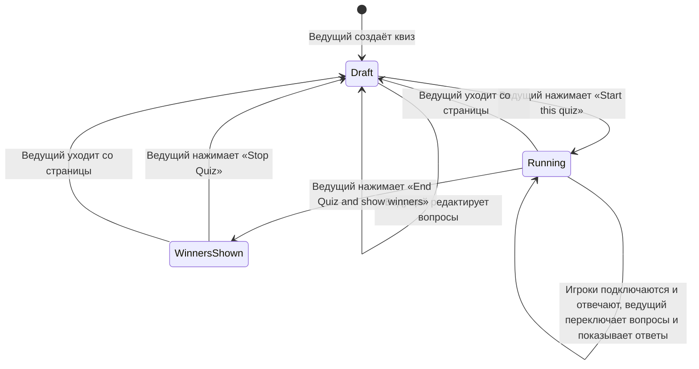
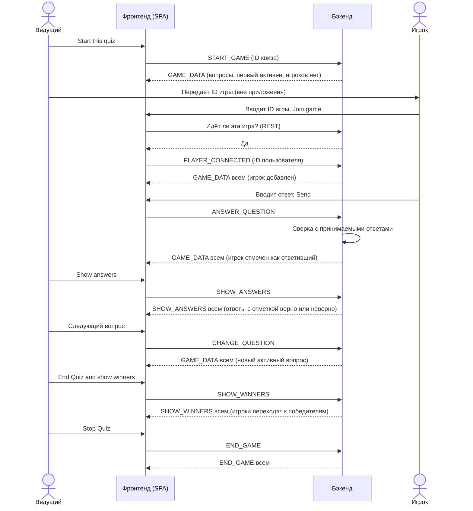

# 6. Сценарий живой игры

Здесь описан текущий сценарий. Сценарий версии 1.0 (лобби, таймер, сеансы с PIN-кодом, переподключение) — в [целевых требованиях](09-target-requirements.md#98-целевой-сценарий-живой-игры).

## Жизненный цикл игры

Состояния: `Draft` — черновик, `Running` — игра идёт, `WinnersShown` — показаны победители.

Квиз можно сыграть повторно: после окончания игры он возвращается в черновик, и его можно запустить снова. Результаты прошлого запуска не сохраняются.

## Сквозной сценарий

## Сообщения реального времени

Все события живой игры идут через одно WebSocket-соединение на вкладку браузера. Каждое сообщение — JSON вида `{ "type": ..., "payload": ... }`.

### От клиентов к серверу

| Сообщение | Кто отправляет | Данные | Бизнес-смысл |
|---|---|---|---|
| `START_GAME` | Ведущий | ID квиза | Запустить квиз вживую |
| `PLAYER_CONNECTED` | Игрок | ID пользователя | Подключиться к идущей игре |
| `CHANGE_QUESTION` | Ведущий | ID вопроса | Сделать вопрос активным |
| `ANSWER_QUESTION` | Игрок | ID вопроса, текст ответа, ID пользователя | Отправить ответ |
| `SHOW_ANSWERS` | Ведущий | ID вопроса | Показать ответы на вопрос |
| `SHOW_WINNERS` | Ведущий | нет | Показать таблицу победителей |
| `END_GAME` | Ведущий | нет | Остановить игру |

### От сервера к клиентам

| Сообщение | Данные | Бизнес-смысл |
|---|---|---|
| `GAME_DATA` | полное состояние живой игры | Изменились игроки, вопросы или активный вопрос |
| `SHOW_ANSWERS` | ответ каждого игрока на вопрос с отметкой верно или неверно | Показ ответов |
| `SHOW_WINNERS` | нет | Перейти к таблице победителей |
| `END_GAME` | нет | Игра окончена |
| `FAULT` | текст ошибки | Действие отклонено (игра уже идёт, игра не идёт) |

Сервер отправляет сообщения **всем** подключённым клиентам, а не только игрокам конкретной игры. Это работает только потому, что одновременно идёт одна игра (BR-20).

Сервер не проверяет, кто отправил сообщение: любой подключённый клиент может отправить сообщения ведущего, например `CHANGE_QUESTION` или `END_GAME` (см. [GAP-3](08-gaps-and-backlog.md)).
