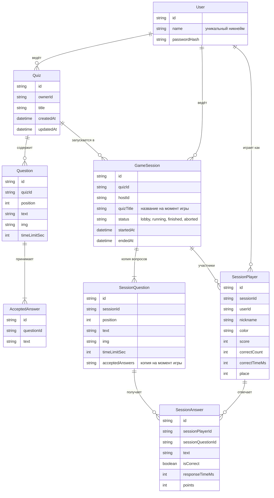
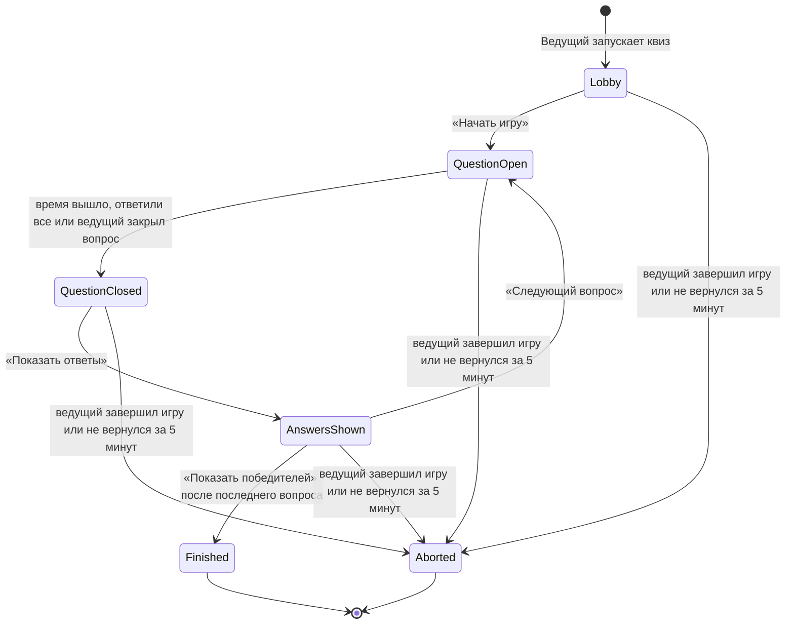

# 9. Целевые требования: версия 1.0

Документы 1–8 описывают, как приложение работает **сейчас**. Этот документ описывает, каким оно должно стать в **версии 1.0**, чтобы им можно было пользоваться по-настоящему: честный подсчёт очков, безопасный вход, несколько игр одновременно, таймер, вход по ссылке и история игр.

ID из документов 1–8 сохраняются. Новые требования продолжают нумерацию (`US-17…`, `FR-50…`, `BR-40…`, `NFR-…8+`). Если требование из документов 1–8 меняется, это указано в разделе [9.3](#93-изменения-существующих-требований).

Параметры с пометкой **(по умолчанию)** выбраны по образцу Kahoot и ждут подтверждения владельца продукта.

## 9.1 Решения владельца продукта

Ответы на открытые вопросы из [бизнес-правил](04-business-rules.md#решения-владельца-продукта), принятые 18.11.2026. Решения D-7–D-9 приняты 20.11.2026.

| ID | Вопрос | Решение |
|---|---|---|
| D-1 | Как сравнивать ответы? | Без учёта регистра и пробелов по краям: `paris`, ` Paris ` и `PARIS` совпадают с `Paris`. |
| D-2 | Что доступно игроку, подключившемуся поздно? | Только текущий вопрос (если время ещё не вышло) и следующие. За пропущенные вопросы — 0 очков. |
| D-3 | Как ранжировать игроков с равными очками? | Выше тот, кто отвечал быстрее. |
| D-4 | Что происходит при коротком отключении игрока? | Ответы и очки сохраняются; при переподключении игрок возвращается в игру. |
| D-5 | Сохранять ли результаты игр? | Да; ведущий видит историю прошлых игр. |
| D-6 | Что входит в версию 1.0? | Несколько игр одновременно, названия квизов, ссылка и QR-код для входа, таймер на вопрос и бонус за скорость. А также все исправления P0 из [бэклога](08-gaps-and-backlog.md). |
| D-7 | Как устроены вход и регистрация? | Гость видит приветственный экран с описанием продукта и кнопками «Войти» и «Зарегистрироваться», ведущими на отдельные страницы. Автоматической регистрации при входе больше нет: вход с неизвестными или неверными данными возвращает ошибку. |
| D-8 | Нужен ли PIN-код для входа в игру? | Нет. Ведущий рассылает ссылку-приглашение (и QR-код с ней); игрок открывает ссылку и попадает сразу в нужный сеанс, ничего не вводя вручную. |
| D-9 | Как хранить сессию входа? | Непрозрачный случайный токен: клиент хранит его в localStorage и отправляет в заголовке `Authorization: Bearer`; в базе — только хеш токена. Аутентификационные cookie не используются; принятый риск XSS задокументирован. |

Из решений D-2 и D-6 следует ещё одно: вопросы идут **строго по порядку**, и каждый вопрос играется один раз. Возвращаться к прошлым вопросам больше нельзя: с таймером и очками за скорость это нарушило бы честность игры.

## 9.2 Границы версии 1.0

### Входит

- Всё, что работает сейчас (документы 1–8), с изменениями из раздела 9.3
- Приветственный экран для гостя и отдельные страницы входа и регистрации
- Безопасный вход: хеш паролей, серверная сессия, проверка владельца (P0)
- Честная игра: один ответ на вопрос, правильность скрыта до показа ответов (P0)
- Названия квизов, удаление квиза, порядок вопросов
- Сеанс игры со ссылкой-приглашением и QR-кодом; лобби перед первым вопросом
- Несколько игр одновременно
- Таймер на вопрос и очки за скорость
- Переподключение игрока и ведущего без потери прогресса
- История игр у ведущего
- Понятные сообщения об ошибках, автотесты и CI

### Не входит (после 1.0)

- Вопросы с выбором из вариантов
- Рейтинг после каждого вопроса
- Вход гостем только по никнейму
- Публичная библиотека квизов и обмен квизами
- История игр для игроков
- Сохранение идущих игр при перезапуске сервера

## 9.3 Изменения существующих требований

| ID | Сейчас | В версии 1.0 |
|---|---|---|
| BR-2 | Вход с незарегистрированным никнеймом создаёт новый аккаунт. | Вход и регистрация — отдельные операции; вход с неизвестным никнеймом отклоняется (BR-83, BR-84). |
| BR-3 | Неверный пароль отклоняется с сообщением «никнейм занят». | Вход отклоняется одинаковой ошибкой и для неизвестного никнейма, и для неверного пароля (BR-84). |
| BR-11 | Вопросы показываются в порядке хранения в базе. | У вопроса есть номер по порядку; ведущий может менять порядок (FR-54). |
| BR-20 | На сервере может идти только одна игра. | Одновременно может идти много игр; у каждой свой сеанс и ссылка-приглашение (BR-50, BR-53). |
| BR-22 | Ведущий выбирает любой вопрос и может вернуться к прошлому. | Вопросы идут строго по порядку; каждый вопрос играется один раз (BR-60). |
| BR-23 | Игрок может подключиться в любой момент и ответить на любой показанный вопрос. | Игрок может подключиться в любой момент до показа победителей; за пропущенные вопросы — 0 очков (D-2, BR-57). |
| BR-25 | Отключившийся игрок удаляется вместе с ответами. | Игрок остаётся в игре со статусом «не в сети», ответы и очки сохраняются до конца игры (D-4, BR-58). |
| BR-26 | Результаты не сохраняются; уход ведущего сразу завершает игру. | Результаты сохраняются в историю (D-5, BR-80). Если ведущий не вернулся за 5 минут, игра прерывается (BR-59). |
| BR-31 | Ответ можно отправить несколько раз; засчитываются все. | Сервер принимает только первый ответ игрока на вопрос (BR-63). |
| BR-32 | Точное сравнение с учётом регистра и пробелов. | Сравнение без учёта регистра и пробелов по краям (D-1, BR-64). |
| BR-34 | Правильность ответов приходит всем клиентам сразу. | До показа ответов игрок знает только, кто ответил; правильность приходит только при показе ответов (BR-66). |
| BR-35 | Очки — число правильных ответов. | Очки начисляются за правильный ответ с бонусом за скорость (BR-70). |
| BR-36 | Порядок при равных очках не определён. | При равных очках выше тот, кто быстрее отвечал (D-3, BR-72). |
| FR-1 | Одна форма: вход или автоматическая регистрация. | Отдельная страница входа только для существующего аккаунта (FR-85). |
| FR-2 | Незарегистрированный никнейм создаёт аккаунт при входе. | Регистрация — отдельная страница и явное действие (FR-86). |
| FR-5 | Без входа доступна только страница входа. | Без входа доступны приветственный экран, вход и регистрация (BR-85). |
| FR-12 | Квизы показаны как «Quiz #N». | У квиза обязательное название (FR-50). |
| FR-26 | Порядок вопросов задаёт база данных. | Ведущий меняет порядок вопросов (FR-54). |
| FR-32 | Ведущий копирует ID квиза. | Ведущий показывает ссылку-приглашение и QR-код (FR-62). |
| FR-35 | Ведущий переключает вопросы в любом порядке. | Ведущий нажимает «Следующий вопрос» (FR-64). |
| FR-39 | Уход ведущего сразу завершает игру. | Ведущий может переподключиться в течение 5 минут (FR-69). |
| FR-49 | Ответы отключившегося игрока теряются. | Ответы сохраняются (FR-77). |
| US-1 | Вход или регистрация за один шаг в одной форме. | Гость выбирает действие на приветственном экране; вход и регистрация разнесены на отдельные страницы (US-31, US-32). |

## 9.4 Новые пользовательские истории

**US-17. Название квиза.** Как ведущий, я хочу дать квизу название, чтобы различать свои квизы.
- При создании квиза запрашивается название.
- Название видно в списке квизов, в конструкторе, в лобби, у игроков и в истории.

**US-18. Удаление квиза.** Как ведущий, я хочу удалить ненужный квиз.
- Удаление требует подтверждения и удаляет вопросы и принимаемые ответы.
- Удалить квиз, по которому сейчас идёт игра, нельзя.
- История прошлых игр по удалённому квизу сохраняется.

**US-19. Порядок вопросов.** Как ведущий, я хочу менять порядок вопросов, чтобы игра шла в нужной последовательности.

**US-20. Время на вопрос.** Как ведущий, я хочу задать время на ответ для каждого вопроса.
- По умолчанию 20 секунд **(по умолчанию)**; можно выбрать 10, 20, 30, 60, 90 или 120 секунд.

**US-21. Лобби.** Как ведущий, я хочу открыть игру и дождаться игроков до первого вопроса.
- После запуска открывается лобби со ссылкой-приглашением, QR-кодом и списком подключившихся игроков.
- Первый вопрос начинается только по кнопке «Начать игру».

**US-22. Вход по ссылке или QR-коду.** Как игрок, я хочу подключиться к игре, отсканировав QR-код или открыв ссылку, без ручного ввода ID.
- Ссылка ведёт на страницу подключения к конкретному сеансу; вводить что-либо вручную не нужно.
- Если игрок не вошёл в аккаунт, после входа он автоматически попадает в игру.

**US-23. Таймер.** Как игрок, я хочу видеть, сколько времени осталось на ответ.
- Обратный отсчёт виден у ведущего и у всех игроков.
- Когда время вышло, ответить уже нельзя.

**US-24. Очки за скорость.** Как игрок, я хочу получать больше очков за быстрый правильный ответ.

**US-25. Подтверждение ответа.** Как игрок, я хочу видеть, что мой ответ принят, но не знать раньше времени, верный ли он.
- После отправки поле ответа блокируется, и видно «Ответ принят».
- Правильность и полученные очки видны только после показа ответов.

**US-26. Возврат в игру.** Как игрок, я хочу вернуться в игру после перезагрузки страницы или обрыва связи и не потерять очки.

**US-27. Возврат ведущего.** Как ведущий, я хочу вернуться к своей игре после перезагрузки страницы, не прерывая её для игроков.

**US-28. Игра закончилась.** Как игрок, я хочу видеть, что ведущий завершил игру, а не застревать на пустом экране.

**US-29. История игр.** Как ведущий, я хочу видеть список прошлых игр с датой, квизом, числом игроков и победителем.

**US-30. Результаты игры.** Как ведущий, я хочу открыть прошлую игру и увидеть итоговую таблицу и ответы каждого игрока на каждый вопрос.

**US-31. Приветственный экран.** Как гость, я хочу понять, что это за приложение, и выбрать — войти или зарегистрироваться.
- Гость, открывший любую страницу, видит приветственный экран.
- Экран кратко описывает продукт и содержит кнопки «Войти» и «Зарегистрироваться», ведущие на соответствующие страницы.

**US-32. Раздельные вход и регистрация.** Как гость, я хочу входить и регистрироваться на разных страницах, чтобы не смешивать два действия в одной форме.
- Страница входа принимает только существующие данные: неизвестный никнейм или неверный пароль показывает ошибку и не создаёт аккаунт.
- Страница регистрации создаёт аккаунт и сразу выполняет вход; занятый никнейм показывает ошибку.
- Страницы входа и регистрации ссылаются друг на друга.

## 9.5 Новые бизнес-правила

### Аккаунты и доступ

| ID | Правило |
|---|---|
| BR-40 | Никнейм: от 3 до 20 символов, пробелы по краям обрезаются, уникален без учёта регистра **(по умолчанию)**. |
| BR-41 | Пароль: не короче 8 символов **(по умолчанию)**. Хранится только хеш пароля. |
| BR-42 | Сессия входа действует 30 дней **(по умолчанию)**; выход завершает её на сервере. |
| BR-43 | Видеть, изменять, удалять и запускать квиз, а также смотреть его историю может только его ведущий (автор). |
| BR-83 | Вход и регистрация — отдельные операции на отдельных страницах. Вход не создаёт аккаунт; успешная регистрация сразу выполняет вход. |
| BR-84 | Вход отклоняется одинаковой ошибкой и для неизвестного никнейма, и для неверного пароля, не раскрывая, что именно неверно. |
| BR-85 | Гость видит приветственный экран с описанием продукта. Все страницы, кроме приветственного экрана, входа и регистрации, требуют входа. |

### Квизы и вопросы

| ID | Правило |
|---|---|
| BR-44 | Название квиза обязательно: от 1 до 80 символов, пробелы по краям обрезаются. Названия могут повторяться. |
| BR-45 | Список квизов отсортирован по дате изменения, новые сверху. |
| BR-46 | Текст вопроса: от 1 до 300 символов. Картинка необязательна, это ссылка `http(s)`. |
| BR-47 | У вопроса от 1 до 10 принимаемых ответов, каждый от 1 до 100 символов. Ответы, совпадающие после нормализации (BR-64), не допускаются. |
| BR-48 | У вопроса есть время на ответ: 10, 20, 30, 60, 90 или 120 секунд; по умолчанию 20 **(по умолчанию)**. |
| BR-49 | Квиз можно запустить, только если в нём хотя бы один вопрос, и у каждого вопроса есть текст и хотя бы один принимаемый ответ. |

### Сеанс игры

| ID | Правило |
|---|---|
| BR-50 | Каждый запуск квиза создаёт отдельный **сеанс игры**. Одновременно может идти много сеансов разных ведущих; события одного сеанса не попадают в другие. |
| BR-51 | У квиза может быть не больше одного идущего сеанса. Ведущий может вести не больше одного сеанса одновременно. |
| BR-52 | Отдельного PIN-кода нет (D-8): подключение к сеансу только по ссылке-приглашению. |
| BR-53 | Ссылка для игроков имеет вид `<адрес фронтенда>/join/<ID сеанса>`; QR-код кодирует эту ссылку. |
| BR-54 | Сеанс использует копию вопросов квиза на момент запуска. Пока сеанс идёт, квиз нельзя редактировать или удалять. |
| BR-55 | Сеанс проходит состояния: лобби → вопрос идёт → вопрос закрыт → ответы показаны → (следующий вопрос) → победители. Ведущий может досрочно завершить сеанс в любом состоянии. |
| BR-56 | Подключиться к сеансу может только пользователь, вошедший в аккаунт. Ведущий не может быть игроком в своём сеансе. |
| BR-57 | Подключиться можно в любом состоянии, кроме «победители». Опоздавший может ответить на текущий вопрос, если время ещё не вышло; за пропущенные вопросы он получает 0 очков. |
| BR-58 | Отключившийся игрок остаётся в сеансе со статусом «не в сети» до конца игры. Его ответы и очки сохраняются; при переподключении он видит текущее состояние игры. |
| BR-59 | Если ведущий отключился, игра продолжается: таймер текущего вопроса идёт, игроки остаются. Если ведущий не вернулся за 5 минут **(по умолчанию)**, сеанс прерывается, а результаты сохраняются со статусом «прервана». |
| BR-60 | Вопросы идут строго по порядку квиза; каждый вопрос играется один раз. После последнего вопроса доступна только кнопка показа победителей. |

### Вопрос, ответ и таймер

Статус: BR-63, BR-64 — **Реализовано** (этап 3 плана реализации); таймер и закрытие вопроса (BR-61, BR-62), видимость ответов (BR-65, BR-66) — этапы 4a/4b.

| ID | Правило |
|---|---|
| BR-61 | Время вопроса отсчитывает сервер. Вопрос начинается, когда ведущий его открывает, и закрывается, когда время вышло, когда ответили все игроки в сети или когда ведущий закрыл его досрочно. |
| BR-62 | Время ответа — время от начала вопроса до получения ответа сервером. Ответ, пришедший после закрытия вопроса, отклоняется. |
| BR-63 | Засчитывается только первый ответ игрока на вопрос; повторные ответы отклоняются. Пустой ответ (после обрезки пробелов) не принимается. Ответ не длиннее 100 символов. |
| BR-64 | **Нормализация:** перед сравнением у ответа игрока и у принимаемых ответов обрезаются пробелы по краям, и буквы приводятся к нижнему регистру. Ответ верный, если после нормализации он совпадает с одним из принимаемых ответов. Пробелы внутри ответа, буквы `ё` и `е` и опечатки не нормализуются. |
| BR-65 | Пока вопрос идёт, игроки и ведущий видят, кто уже ответил, но не видят текст и правильность чужих ответов. Игрок видит свой отправленный текст. |
| BR-66 | Правильность ответов, принимаемые ответы и очки за вопрос сервер отправляет только после того, как ведущий нажал «Показать ответы». Показать ответы можно только после закрытия вопроса. |

### Очки и победители

| ID | Правило |
|---|---|
| BR-70 | За правильный ответ игрок получает `round(1000 × (1 − t / (2 × T)))` очков, где `t` — время ответа, `T` — время на вопрос. Мгновенный ответ даёт 1000 очков, ответ в последний момент — 500 **(по умолчанию)**. |
| BR-71 | За неверный ответ, отсутствие ответа или пропущенный вопрос — 0 очков. Штрафов нет. |
| BR-72 | Таблица победителей отсортирована по очкам по убыванию. При равных очках выше игрок с меньшим суммарным временем правильных ответов. Если совпадает и оно, игроки делят место. |
| BR-73 | В таблице победителей у игрока видны место, никнейм, очки и число правильных ответов. Тройка лидеров выделена. |

### История игр

| ID | Правило |
|---|---|
| BR-80 | Когда сеанс завершается (показаны победители или игра прервана), его результаты сохраняются: квиз и его название на момент игры, ведущий, время начала и окончания, статус («завершена» или «прервана»), игроки с местами, очками и числом правильных ответов, а также ответ каждого игрока на каждый вопрос с правильностью, временем и очками. |
| BR-81 | Историю видит только ведущий. Удаление или изменение квиза не меняет сохранённую историю. |
| BR-82 | Ведущий может удалить запись из истории. Иначе история хранится бессрочно. |

## 9.6 Новые функциональные требования

Статус у всех новых требований — «Не реализовано», если не указано иное.

### Вход и аккаунт

Статус: FR-84–FR-87 — **Реализовано** (этап 1 плана реализации).

| ID | Требование |
|---|---|
| FR-84 | Гость видит приветственный экран с описанием продукта и кнопками «Войти» и «Зарегистрироваться», ведущими на соответствующие страницы (US-31, BR-85). |
| FR-85 | Страница входа принимает никнейм и пароль; неизвестные или неверные данные отклоняются ошибкой, аккаунт не создаётся (BR-83, BR-84). |
| FR-86 | Страница регистрации создаёт аккаунт и сразу выполняет вход; занятый никнейм показывает ошибку (BR-40, BR-41). |
| FR-87 | Страницы входа и регистрации ссылаются друг на друга и на приветственный экран; вошедший пользователь, открывший любую из гостевых страниц, перенаправляется на главную. |

### Квизы

Статус: FR-50–FR-52, FR-54–FR-56 — **Реализовано** (этап 2 плана реализации). Контрол времени на вопрос заложен в форме, сама настройка — этап 4b (FR-53).

| ID | Требование |
|---|---|
| FR-50 | Ведущий задаёт название при создании квиза и может изменить его в конструкторе (BR-44). |
| FR-51 | Список квизов показывает название, число вопросов и дату изменения (BR-45). |
| FR-52 | Ведущий может удалить квиз с подтверждением; удаляются вопросы и принимаемые ответы (US-18). |
| FR-53 | Ведущий задаёт время на ответ для каждого вопроса (BR-48). |
| FR-54 | Ведущий меняет порядок вопросов перетаскиванием или кнопками «вверх» и «вниз» (BR-11). |
| FR-55 | Конструктор показывает, какие вопросы не готовы к игре; кнопка запуска недоступна, пока квиз не готов (BR-49, FR-27). |
| FR-56 | Конструктор проверяет ограничения BR-46 и BR-47 и показывает ошибку у конкретного поля. |

### Ведущий: живая игра

| ID | Требование |
|---|---|
| FR-60 | Запуск квиза создаёт сеанс и открывает лобби (BR-50, BR-55). |
| FR-61 | Если по квизу уже идёт сеанс или ведущий уже ведёт другой сеанс, система предлагает вернуться в него (BR-51). |
| FR-62 | В лобби и во время игры ведущий видит ссылку-приглашение для игроков (с кнопкой копирования) и QR-код (BR-52, BR-53). |
| FR-63 | Ведущий видит список игроков со статусом «в сети» или «не в сети» и числом игроков. |
| FR-64 | Ведущий начинает игру и переходит к следующему вопросу кнопкой; выбрать произвольный вопрос нельзя (BR-60). |
| FR-65 | Ведущий видит таймер, текущий вопрос, номер вопроса из общего числа и счётчик «ответили N из M». |
| FR-66 | Ведущий может закрыть вопрос досрочно (BR-61). |
| FR-67 | После закрытия вопроса ведущий нажимает «Показать ответы»; всем показываются принимаемые (правильные) ответы — в том числе когда никто из игроков не ответил верно — и ответ каждого игрока с отметкой «верно» или «неверно» и очками (BR-66). |
| FR-68 | После последнего вопроса ведущий нажимает «Показать победителей»; всем показывается таблица победителей (BR-72, BR-73). |
| FR-69 | После перезагрузки страницы ведущий возвращается в свой сеанс в текущем состоянии (BR-59). |
| FR-70 | Ведущий может досрочно завершить игру с подтверждением; результаты сохраняются со статусом «прервана». |

### Игрок: живая игра

| ID | Требование |
|---|---|
| FR-71 | Игрок подключается, открывая ссылку-приглашение или сканируя QR-код (BR-52, BR-53). |
| FR-72 | Если пользователь не вошёл в аккаунт, после входа он попадает в игру, на которую вела ссылка. |
| FR-73 | Если ссылка недействительна или игра закончилась, игрок видит понятное сообщение. |
| FR-74 | В лобби игрок видит название квиза, свой никнейм и список игроков. |
| FR-75 | Игрок видит текущий вопрос, номер вопроса и таймер; когда время вышло, поле ответа блокируется (BR-61, BR-62). |
| FR-76 | После отправки поле ответа блокируется, игрок видит «Ответ принят» и свой текст без отметки о правильности (BR-63, BR-65). |
| FR-77 | После перезагрузки страницы или обрыва связи игрок автоматически возвращается в игру с сохранёнными ответами и очками (BR-58). |
| FR-78 | При показе ответов игрок видит, верен ли его ответ, сколько очков он получил и какие ответы принимались. |
| FR-79 | Когда игра завершена или прервана, игрок видит таблицу победителей или сообщение «Игра завершена ведущим» и кнопку возврата на главную (FR-48). |

### История игр

| ID | Требование |
|---|---|
| FR-80 | У ведущего есть страница «История игр»: дата, название квиза, статус, число игроков, победитель; новые сверху (BR-80). |
| FR-81 | Страница результатов игры показывает таблицу победителей и разбор по вопросам: ответ каждого игрока, правильность, время, очки. |
| FR-82 | Ведущий может удалить запись истории с подтверждением (BR-82). |
| FR-83 | Из карточки квиза можно перейти к истории игр по этому квизу. |

## 9.7 Целевая доменная модель

- `Quiz` — это нынешняя сущность `Game`. Переименовывать её в коде не обязательно, но в интерфейсе и документах это «квиз».
- Связи — внешние ключи. Удаление квиза каскадно удаляет вопросы и принимаемые ответы, но не сеансы: история хранит копию вопросов (`SessionQuestion`) и название квиза.
- Состояние идущего сеанса (текущий вопрос, время начала, кто в сети) хранится в памяти сервера, отдельно для каждого сеанса. Результаты записываются в базу, когда закрывается вопрос и когда сеанс заканчивается.

## 9.8 Целевой сценарий живой игры

Состояния: `Lobby` — лобби, `QuestionOpen` — вопрос идёт, `QuestionClosed` — вопрос закрыт, `AnswersShown` — ответы показаны, `Finished` — победители показаны, `Aborted` — игра прервана. Результаты сохраняются в состояниях `Finished` и `Aborted`.

### Сообщения реального времени

- WebSocket-соединение открывается для конкретного сеанса. Сервер определяет пользователя по одноразовому билету, выданному под сессию входа, а не по ID в сообщении (D-9).
- Сообщения ведущего сервер принимает только от ведущего этого сеанса.
- Сервер отправляет события только участникам этого сеанса.

**От клиентов к серверу**

| Сообщение | Кто отправляет | Данные | Бизнес-смысл |
|---|---|---|---|
| `JOIN_SESSION` | Ведущий или игрок | ID сеанса | Подключиться или переподключиться к сеансу |
| `START_GAME` | Ведущий | нет | Начать первый вопрос из лобби |
| `NEXT_QUESTION` | Ведущий | нет | Начать следующий вопрос |
| `CLOSE_QUESTION` | Ведущий | нет | Закрыть вопрос досрочно |
| `SHOW_ANSWERS` | Ведущий | нет | Показать ответы на закрытый вопрос |
| `SHOW_WINNERS` | Ведущий | нет | Показать таблицу победителей |
| `END_SESSION` | Ведущий | нет | Досрочно завершить игру |
| `ANSWER_QUESTION` | Игрок | ID вопроса, текст | Отправить ответ |

**От сервера к клиентам**

| Сообщение | Кому | Данные | Бизнес-смысл |
|---|---|---|---|
| `SESSION_STATE` | Всем в сеансе | состояние, название квиза, игроки (никнейм, цвет, в сети, ответил ли), текущий вопрос без принимаемых ответов, номер вопроса, время окончания вопроса, время сервера | Изменилось публичное состояние игры |
| `ANSWER_ACCEPTED` | Игроку, который ответил | ID вопроса, текст | Ответ принят |
| `QUESTION_CLOSED` | Всем в сеансе | ID вопроса | Отвечать больше нельзя |
| `ANSWERS_REVEALED` | Всем в сеансе | принимаемые ответы; ответ, правильность и очки каждого игрока | Показ ответов |
| `WINNERS` | Всем в сеансе | места, никнеймы, очки, число правильных ответов | Таблица победителей |
| `SESSION_ENDED` | Всем в сеансе | причина: «завершена», «прервана ведущим», «ведущий не вернулся» | Игра окончена |
| `ERROR` | Отправителю | код и текст ошибки | Действие отклонено |

Время окончания вопроса и время сервера нужны, чтобы таймер у всех клиентов показывал одно и то же, даже если часы устройства спешат.

## 9.9 Новые нефункциональные требования

Требования NFR-S1–S6 (безопасность) из [документа 7](07-non-functional-requirements.md) обязательны для версии 1.0. Дополнительно:

| ID | Требование |
|---|---|
| NFR-S8 | Сессия — непрозрачный случайный токен (уточняет NFR-S2, D-9): клиент хранит его в localStorage и отправляет в `Authorization: Bearer`; в базе — только хеш токена, ID пользователя в токене нет. Аутентификационные cookie не используются. WebSocket подключается по одноразовому короткоживущему билету. |
| NFR-S9 | Не больше 10 попыток входа в минуту с одного IP-адреса **(по умолчанию)**. |
| NFR-S10 | Сервер проверяет длину и формат всех входных данных (BR-40–BR-48, BR-63) независимо от фронтенда. |
| NFR-P5 | Один экземпляр сервера выдерживает 20 одновременных сеансов по 50 игроков **(по умолчанию)**. |
| NFR-P6 | Таймер у всех участников расходится не больше чем на 1 секунду. |
| NFR-R5 | Игрок и ведущий переподключаются автоматически, без действий пользователя, при обрыве связи до 5 минут. |
| NFR-R6 | Результаты каждого закрытого вопроса записываются в базу сразу, чтобы при сбое сервера сохранилась история до последнего закрытого вопроса. |
| NFR-R7 | В версии 1.0 допускается, что идущие сеансы прерываются при перезапуске сервера. Такие сеансы попадают в историю со статусом «прервана». |
| NFR-U5 | Экран игрока удобен на телефоне с шириной экрана от 360 px: вопрос, таймер и поле ответа видны без прокрутки. |
| NFR-U6 | Все ошибки показываются понятным текстом на языке интерфейса; API возвращает правильный HTTP-код и JSON `{ "code": ..., "message": ... }` (GAP-14). |
| NFR-O4 | Юнит-тесты покрывают нормализацию ответов, подсчёт очков и ранжирование; сквозной тест проходит игру от запуска до истории; тесты запускаются в CI в каждом PR (GAP-16). |

## 9.10 Критерии готовности версии 1.0

1. Все требования из разделов 9.3–9.9 реализованы, а статусы в документах 3 и 7 обновлены.
2. Пробелы GAP-1–GAP-17 закрыты (кроме вынесенных за пределы версии 1.0).
3. Сквозной сценарий проходит на продакшене: два ведущих одновременно проводят игры по 5 вопросов, в каждой не меньше 3 игроков; один игрок перезагружает страницу посреди игры; один игрок подключается после второго вопроса.
4. Итоговые очки в таблице победителей и в истории совпадают с расчётом по BR-70–BR-72.
5. В инструментах разработчика браузера игрок не видит правильность чужих и своих ответов до показа ответов.
